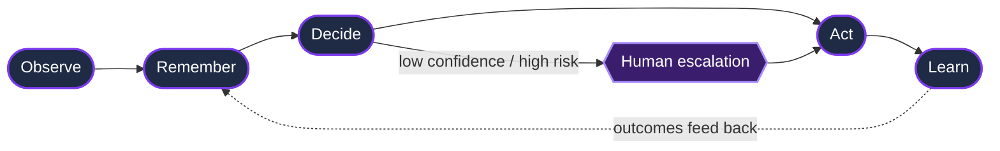

<div align="center">


<a href="https://portfolio.davletvm.workers.dev/">
  
</a>

<p>
  <a href="https://portfolio.davletvm.workers.dev/"></a>
  <a href="https://brain-engine.davletvm.workers.dev/"></a>
  <a href="https://www.linkedin.com/in/devlet-ataoglu/"></a>
  <a href="mailto:davletvm@gmail.com"></a>
  <a href="https://portfolio.davletvm.workers.dev/assets/davlet-ataoglu-cv.pdf"></a>
</p>

</div>

## About

I build the **memory and retrieval layers that let LLM agents work over long horizons** — and the calibration and guardrails that decide when an agent is allowed to act on its own.

My background runs through the Linux kernel and virtualization, Kubernetes, developer tools and JavaScript engine performance. That is why my AI work is mostly about state, uncertainty and failure, and less about prompts.

```python
davlet = {
    "now":       "Creator of Brain Engine — memory and decision layer for autonomous operations",
    "research":  ["token-free recall", "bi-temporal knowledge graphs", "learning from incidents"],
    "position":  "recall is reconstruction and association, not text generation",
    "languages": ["Turkish", "Russian", "English", "Serbian"],
    "open_to":   "relocation · pilots · research collaboration",
}
```

## Brain Engine &nbsp;

An autonomous agent that runs a short-term rental business without a human in the loop. It reads every incoming message, watches device state, works out what the situation actually is, decides, and acts. It escalates to a human only when its own confidence or the risk of the action says it should.

<div align="center">

| 184K | 725 | 7 | 562 | 6+ | 50+ |
|:---:|:---:|:---:|:---:|:---:|:---:|
| lines of Python | files | memory tiers | eval scenarios, 15 stages | message channels | connected devices |

</div>



<details>
<summary><b>How it works</b></summary>
<br />

| Layer | What is inside |
|---|---|
| **Memory** | Seven tiers over a bi-temporal knowledge graph with soft-invalidate semantics and point-in-time navigation. It answers not just *what is true* but *what did I believe when I made that call*. |
| **Retrieval** | Hybrid dense/sparse search in Qdrant with cross-encoder reranking (bge-reranker-v2-m3 via TEI). One multilingual index serves Russian, Turkish and English. |
| **Harness** | **Brain Graph** — my own agent-graph execution engine for long-lived, resumable, stateful runs over a custom bi-temporal timeline. |
| **Decisions** | DecisionCase → PatternMiner → ConditionSynthesizer → Wilson lower-bound scoring → Validator → RuleStore. Rules are mined from outcomes, not hand-written. |
| **Calibration** | Mondrian conformal prediction and beta calibration, so autonomy rests on real confidence intervals instead of raw model scores. |
| **Evaluation** | 562-scenario taxonomy across 15 stages, RAGAS baselines and an LLM-as-judge harness gating the production path. |
| **Safety** | Six-tier guardrails and an autonomy state machine: `OBSERVE → SEMI_AUTO → AUTOPILOT`. The agent earns write access per scenario class by measured reliability. |
| **Applied ML** | LightGBM + SHAP fraud-risk scoring with per-decision attribution shown to reviewers. |

</details>

## Research

| Project | Status | Idea |
|---|---|---|
| **Memory Engine** | in build | Token-free recall: graph traversal, cross-encoder scoring and a bandit access controller, with **no generative model in the loop**. Builds on ideas from KGERMAR, MemCon, MRAgent, Graphiti and Mem0. |
| **Lessons Store** | research | Learning from incidents the way people do: extract *incident → cause → prescription*, then surface the lesson in structurally similar situations. Behavioral improvement without retraining. |
| **Brain Engine 3.0** | architecture | A computable enterprise platform: eleven composable runtime layers and a MetaModel architecture-search subsystem. Principle: *composable intelligence, deterministic execution*. |

## Career

| Company | Role | What I worked on |
|---|---|---|
| **Brain Engine** | Creator | Memory, MetaModel and decision layers for an enterprise intelligence system. |
| **Cendra** | Founding Engineer · Chief Architect | Chief architect and primary developer of an AI operations platform for property management and short-term rentals. **The product raised $1M in investment.** 6+ unified channels, 50+ home-automation integrations, escalation and on-call layer. |
| **Ruwada AI** | Co-Founder | Zero to product. First generation of Brain Engine; founder-led sales and customer integrations. |
| **Mozilla** | Staff Software Engineer | Test engineering lead for Firefox Telemetry (Python, Docker, BigQuery). JavaScript performance. Monitor team (React, TypeScript, Next.js). Telemetry-informed funnel work contributed to a **54% reduction in user churn**. Co-led Continuous Deployment adoption with a DORA-metrics service catalog. |
| **Opera** | Full Stack Engineer | Recommendation systems and serving infrastructure, Node.js microservices, Opera Mini for Android. Led a team technically and as manager. |
| **Red Hat** | Principal Staff Software Engineer | Core kernel team: Linux kernel for RHEL and Fedora, C, eBPF, clang/LLVM. Kubernetes. |
| **Microsoft** | Staff Software Engineer | .NET platform. First ML/AI work. |
| **Yandex** | Software Engineer | Yandex.Maps, Yandex.Music, search and information retrieval at Yandex Labs. |
| **JetBrains** | Software Engineer | IDE development (WebStorm, PhpStorm), Android tooling. |
| **Parallels** | Linux Kernel Developer | Linux kernel and virtualization: OpenVZ, KVM, memory and device cgroups. |
| **Borland** | Software Engineer | C++ Builder. |

<sub>M.Sc. Computer Science, Bauman Moscow State Technical University · Executive programs: MIT Sloan (Digital Business Strategy), INSEAD (Digital Strategy), Harvard Business School (Digital Transformation)</sub>

## Stack

**Agents & retrieval**


**Machine learning**


**Systems**


## Activity

<div align="center">


<picture>
  <source media="(prefers-color-scheme: dark)" srcset="https://raw.githubusercontent.com/Godek87/Godek87/output/github-contribution-grid-snake-dark.svg" />
  
</picture>

</div>

<div align="center">


<sub>Open to pilots, research collaboration and relocation · <a href="mailto:davletvm@gmail.com">davletvm@gmail.com</a></sub>

</div>
